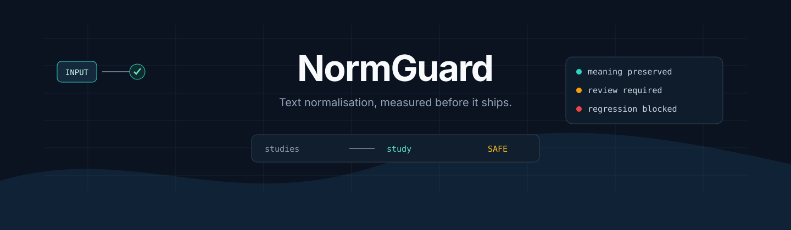
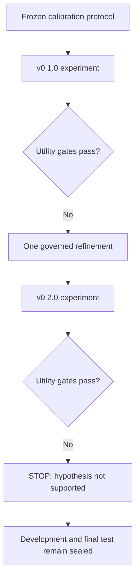

<div align="center">



[](docs/adr/0002-stop-general-lemmatisation.md)
[](docs/adr/0002-stop-general-lemmatisation.md)
[](LICENSE)

**An evidence-first quality and safety research toolkit for text normalisation in search, NLP and RAG pipelines.**

[Final decision](docs/adr/0002-stop-general-lemmatisation.md) ·
[Architecture](docs/architecture.md) ·
[Evaluation protocol](research/evaluation-plan.md) ·
[ESCI protocol](docs/esci-dataset.md) ·
[Contributing](CONTRIBUTING.md)

</div>

> [!IMPORTANT]
> NormGuard completed a focused proof of concept. Its protected-terminology safety
> controls passed, but the evaluated general-lemmatisation approach did not achieve
> the pre-registered retrieval-utility gates. It is not approved as a production
> retrieval recommendation.

## Research outcome

NormGuard tested whether policy-first English lemmatisation could improve lexical
BM25 retrieval while preserving terminology whose exact form matters.

Two governed experiments were completed on the frozen Amazon ESCI calibration
partition:

| Measure | v0.1.0 | v0.2.0 conservative refinement |
|---|---:|---:|
| C0 nDCG@10 | 0.812533 | 0.812533 |
| C4 nDCG@10 | 0.814379 | 0.813144 |
| Mean paired delta | +0.001846 | +0.000611 |
| CI95 lower bound | -0.000913 | -0.000811 |
| Exact identifier retention | 1.000000 | 1.000000 |
| Protected-term violation rate | 0.000000 | 0.000000 |
| S0 events | 0 | 0 |
| Decision | REVIEW | REVIEW |

The required utility gain was at least `+0.005` with a CI95 lower bound above
zero. Neither configuration passed. The single permitted refinement reduced the
estimated gain, so further tuning on the frozen calibration partition was stopped.

Development and official-test partitions remained sealed and were not read or
transformed. See
[ADR 0002](docs/adr/0002-stop-general-lemmatisation.md) for the accepted decision,
limitations and rejected alternatives.

## What the repository demonstrates

The negative utility result does not invalidate the independently tested engineering
and governance controls:

- deterministic P0–P3 protected-term policies;
- policy-first normalisation with offset-preserving span traces;
- pinned C0 and spaCy-backed C4 adapters;
- deterministic ESCI split and artifact verification;
- paired BM25 retrieval evaluation and statistical evidence;
- terminology-safety auditing and explicit failure taxonomy;
- two-reviewer policy review, merge and resolution workflow;
- tamper-evident JSON, Markdown and SVG reports;
- calibration diagnostics that fail closed;
- CI checks using locked dependencies and reproducible tests.

## Decision flow



Safety passing was necessary but not sufficient for promotion. NormGuard deliberately
records a defensible negative result instead of converting descriptive improvements
into an unsupported recommendation.

## Core commands

Install the locked development environment and run the contract suite:

```bash
uv sync --locked --all-extras --dev
uv run --locked ruff check src tests scripts
uv run --locked python -m unittest discover -s tests -v
```

The repository contains guarded calibration/development tooling, but ADR 0002
prohibits additional tuning against the completed calibration partition and does
not authorize development or official-test access.

## Repository map

```text
src/normguard/
  adapters.py                  C0 and policy-aware spaCy adapters
  calibration_diagnostics.py  guarded descriptive diagnostics
  contracts.py                 policy, trace, failure and evidence contracts
  esci.py                      ESCI artifact verification and split manifest
  esci_experiment.py           sealed partition loading
  experiment.py                deterministic paired statistics
  experiment_runner.py         guarded experiment orchestration
  normalisation.py             policy-first protected normalisation
  policy_candidates.py         calibration-only review candidate generation
  policy_io.py                 policy and approval validation
  policy_review.py             two-reviewer merge and resolution
  reporting.py                 decisions and tamper-evident reports
  retrieval.py                 paired BM25 evaluation
  safety.py                    terminology-safety auditing
docs/
  adr/                         accepted architecture and research decisions
  evidence-reporting.md        reporting and diagnostic contracts
  policy-candidate-review.md   reviewer workflow
  protected-normalisation.md   safety semantics
  retrieval-evaluation.md      retrieval protocol
  terminology-safety-audit.md  failure and safety model
research/
  charter.md                   original research questions
  evaluation-plan.md           frozen evaluation plan
  landscape.md                 prior-art and product landscape
tests/                         deterministic contract and regression tests
```

## Future product boundary

A future **NormGuard Safety Core** may productize the reusable policy, trace,
review, safety-audit and evidence components for search, RAG and LLM preprocessing
systems. That would be a separate product phase with its own users, API contract,
threat model, success measures and release criteria.

Any new retrieval experiment requires a new protocol and a new data boundary. It
must not reuse the completed calibration partition for exploratory tuning or imply
that the rejected general-lemmatisation hypothesis has been revived.

## Licence

Apache-2.0. Third-party software, models and datasets retain their own licences.
