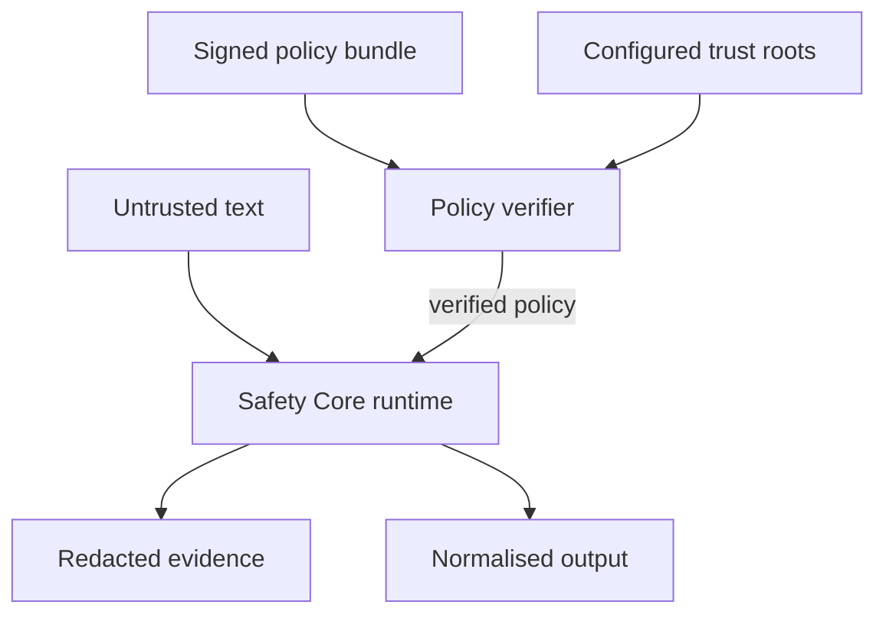

# ADR 0003: Establish NormGuard Safety Core as an offline deterministic control layer

- **Status:** Proposed
- **Date:** 2026-10-21
- **Decision owners:** NormGuard maintainers
- **Issue:** #62
- **Supersedes:** None
- **Related:** ADR 0002

## Context

ADR 0002 stopped the general-lemmatisation retrieval hypothesis because it did not
meet the pre-registered utility gates. That decision did not invalidate the
independently useful policy, protected-span, reviewer, safety-audit and
tamper-evident evidence components.

Those components need a clear product boundary before further implementation.
Without one, NormGuard risks coupling safety controls to a rejected retrieval
experiment, exposing sensitive text through evidence, or creating a network
service before its policy and runtime contracts are stable.

## Decision

NormGuard Safety Core will be an offline, deterministic and fail-closed control
layer for governed text transformations.

The Python library is the authoritative runtime. A CLI will expose policy
validation, verification and local evaluation for engineers and CI. A network
service, managed registry, user interface and multi-tenant operation are deferred
until the local contracts and security controls are stable.

The first vertical slice protects:

- brands and organisation names;
- product models and SKUs;
- measurements and technical specifications;
- security identifiers and control references;
- approved aliases;
- terms requiring human review.

This phase does not resume general-purpose lemmatisation research and does not
authorise access to sealed ESCI development or official-test partitions.

## Component boundaries

| Component | Responsibility | Must not do |
|---|---|---|
| Policy bundle | Declare identity, version, rules, provenance, approvals and integrity metadata | Execute transformations or contain secrets |
| Policy verifier | Parse, canonicalise, validate integrity, compatibility and trust | Repair, silently downgrade or auto-approve a policy |
| Safety runtime | Match protected spans and apply explicit P0–P3 behaviour deterministically | Make network calls, infer missing approvals or mutate policy |
| Evidence builder | Produce schema-versioned decisions, spans, digests and safety events | Record raw sensitive input by default |
| Python SDK | Provide stable validation and normalisation interfaces | Depend on CLI or service infrastructure |
| CLI | Expose SDK operations to humans and CI with machine-readable output | Implement behaviour that differs from the SDK |
| Future service adapter | Add authentication, tenancy, quotas and transport | Become the source of policy semantics |

## Trust boundaries



Text and policy files are untrusted inputs. Trust roots and runtime configuration
are controlled inputs. No policy may execute until verification succeeds. The core
does not call external systems, download dependencies or resolve policies over the
network.

## Policy lifecycle

A policy bundle must contain:

- immutable policy identifier;
- semantic policy version;
- policy schema version;
- minimum and maximum compatible runtime schema versions;
- ordered P0–P3 rules with stable rule identifiers;
- provenance and source references;
- reviewer approval metadata;
- creation timestamp;
- canonical content digest;
- signature envelope and signing-key identifier.

Canonical serialization must produce stable bytes before hashing or signing.
SHA-256 provides content integrity; an approved digital-signature mechanism
provides authenticity. A checksum alone is not an authorization control.

Policy authoring, review, signing, publication and activation are separate
responsibilities. Production deployment should require at least two-person review.
The consumer must use a configured allowlist of trust roots and policy identities.

Rollback is denied by default when the proposed policy version is below the
recorded activation floor. Emergency rollback requires an explicit, auditable
override referencing an incident or change record. The core runtime consumes an
already selected bundle; it does not select the newest policy itself.

The precise signature technology is intentionally deferred to a short design
spike. Candidate implementations must support offline verification, key rotation,
revocation metadata and common CI/cloud key-management systems.

## Runtime semantics

- P0: preserve the matched surface exactly.
- P1: emit only the approved alias declared by the verified rule.
- P2: apply only the explicit, bounded transformation declared by policy.
- P3: preserve the surface and emit a review-required decision.
- Overlaps use deterministic leftmost-longest selection with a documented class
  and rule-ID tie-break.
- Invalid policies, unsupported schemas, failed signatures, integrity failures,
  ambiguous unresolved rules and evidence-construction failures stop processing.
- Identical input, runtime configuration and verified policy must produce the same
  semantic result.
- Limits for input bytes, rule count, pattern length, match count, execution time
  and evidence size must be configurable and tested.
- The runtime must be safe for concurrent read-only use after policy construction.

User text never changes the active policy, trust roots, limits or evidence mode.
Instructions embedded in text are data, not runtime commands. This is the primary
prompt-injection boundary.

## Public interface direction

The SDK will expose explicit operations equivalent to:

```python
verified = verify_policy(bundle_bytes, trust_store, activation_state)
result = normalise(text, verified, limits=limits)
```

Results must distinguish successful output, review-required outcomes and typed
failures. They include policy identity and digest, matched rule IDs, offset-aware
decisions, safety events, timing metadata and an input digest. Raw input inclusion
requires an explicit opt-in evidence policy and is never the default.

The CLI will expose the same contracts:

```text
normguard policy verify POLICY --trust-store TRUST_STORE --json
normguard normalise --policy POLICY --input-file INPUT --json
```

Exit codes must distinguish success, review required, invalid input, untrusted
policy, incompatible schema and internal failure. Secrets and raw input must not
appear in command-line arguments, logs or default error output.

## Evidence and observability

Evidence must be canonical and schema-versioned. Each decision records:

- unique decision identifier;
- runtime and evidence schema versions;
- policy ID, version and digest;
- input digest and input byte length;
- rule IDs, source spans, emitted spans and P0–P3 decisions;
- review and safety events;
- duration, limit consumption and terminal status.

Default logs contain identifiers, digests, counts, durations and error codes only.
Raw text, approved aliases that contain confidential values, policy signatures and
trust-store material are excluded. Metrics must have bounded cardinality and must
not use raw surfaces, digests or decision IDs as labels.

The future service adapter may emit OpenTelemetry traces and metrics, but the core
must not require an observability backend.

## Security and operational controls

- Reject unknown fields where contracts require closed schemas.
- Parse data formats without dynamic object construction or code execution.
- Resolve file access in the CLI without following unsafe paths by default.
- Pin dependencies and preserve locked CI execution.
- Generate an SBOM and run dependency and secret scanning before release.
- Keep signing keys outside the repository and runtime artifacts.
- Record policy activation, rollback and trust-root changes as auditable events.
- Define incident procedures for policy compromise, key compromise, unsafe
  transformation, evidence leakage and availability degradation.

The detailed abuse cases and mitigations are maintained in
[the Phase 3 threat model](../threat-model-safety-core.md).

## Non-functional gates

Initial release candidates must demonstrate:

| Property | Gate |
|---|---|
| P0 exact retention | 100% on the approved safety suite |
| Unauthorized transformations | Zero |
| Determinism | Identical semantic output for repeated identical runs |
| Tamper handling | Invalid policy and evidence artifacts fail closed |
| Privacy | No raw text in default logs or evidence |
| Compatibility | Unsupported schema versions fail before normalisation |
| Performance | Declared environment, corpus and percentile budgets |
| Reliability | Unit, contract, property, adversarial and reproducibility tests pass |

A numeric latency budget will be frozen with the benchmark fixture before runtime
optimisation. It must not be selected after observing multiple candidate
implementations.

## Data and evaluation boundary

Phase 3 uses synthetic fixtures and explicitly approved safety calibration
artifacts. The completed ESCI calibration partition cannot be used for additional
tuning. ESCI development and official-test partitions remain sealed.

External data, including Kaggle datasets, belongs to a separately documented
robustness track. Each source requires licence, provenance, privacy, leakage and
representativeness review before use.

## Deployment direction

The initial release is an embedded library and CLI. A later FastAPI adapter may be
approved only after the core contracts pass their release gates. That service
would require:

- authenticated and authorised policy access;
- tenant isolation;
- request-size limits, quotas and timeouts;
- idempotency and request correlation;
- encrypted transport and storage;
- safe caching keyed by tenant, policy digest and runtime version;
- health, readiness and dependency signals;
- horizontal scaling without mutable in-process policy administration.

Docker, Kubernetes and cloud deployment are therefore design constraints, not
deliverables of the first vertical slice.

## Alternatives considered

### Build FastAPI first

Rejected for the first slice. Transport, authentication and operations would add
risk before the policy and evidence semantics are stable.

### Build a centralized policy database first

Rejected. A managed registry is valuable later, but signed immutable bundles make
trust and reproducibility testable without creating an early control-plane
dependency.

### Reuse the retrieval experiment as the product API

Rejected. It would bind the product to a hypothesis stopped by ADR 0002 and mix
safety success with unsupported utility claims.

### Use an LLM to classify or rewrite protected terms

Rejected for the core. It would weaken determinism, increase injection exposure and
make exact identifier guarantees difficult to prove.

### Store raw input for auditability

Rejected as the default. Content digests and structured decisions support integrity
checking while reducing leakage. Explicit, access-controlled diagnostic capture may
be designed separately.

### Trust checksums without signatures

Rejected for published policies. Hashes detect changes but do not establish who
authorised the content.

## Consequences

### Positive

- Safety semantics remain independent of transport and retrieval architecture.
- Offline verification reduces availability and supply-chain dependencies.
- Signed immutable bundles support reproducible deployments and controlled
  rollback.
- Privacy-safe evidence improves enterprise adoption and auditability.
- Stable SDK semantics can later support CLI, FastAPI and batch adapters.

### Negative

- Signing, trust-root rotation and rollback protection add operational ownership.
- Exact matching and bounded explicit transformations cover less than an
  open-ended language model.
- The embedded model requires applications to upgrade the package and policy
  deliberately.
- Performance gates require a representative benchmark before production claims.

## Implementation sequence

1. Freeze policy-bundle, trust and evidence schemas.
2. Add canonical serialization and integrity verification.
3. Complete the signature design spike and record the selected mechanism.
4. Implement runtime limits and typed failures.
5. Expose stable SDK interfaces.
6. Add CLI parity and machine-readable exit behaviour.
7. Add property, fuzz, adversarial and reproducibility tests.
8. Freeze and execute the performance benchmark.
9. Publish an operational runbook and release checklist.
10. Reassess whether a FastAPI service is justified.

## Review triggers

Revisit this ADR if:

- the core requires a network dependency;
- a supported use case cannot be expressed with deterministic P0–P3 semantics;
- signature or rollback requirements change;
- evidence needs conflict with privacy requirements;
- multi-tenant service deployment is approved;
- a new research protocol proposes retrieval-dependent behaviour.
