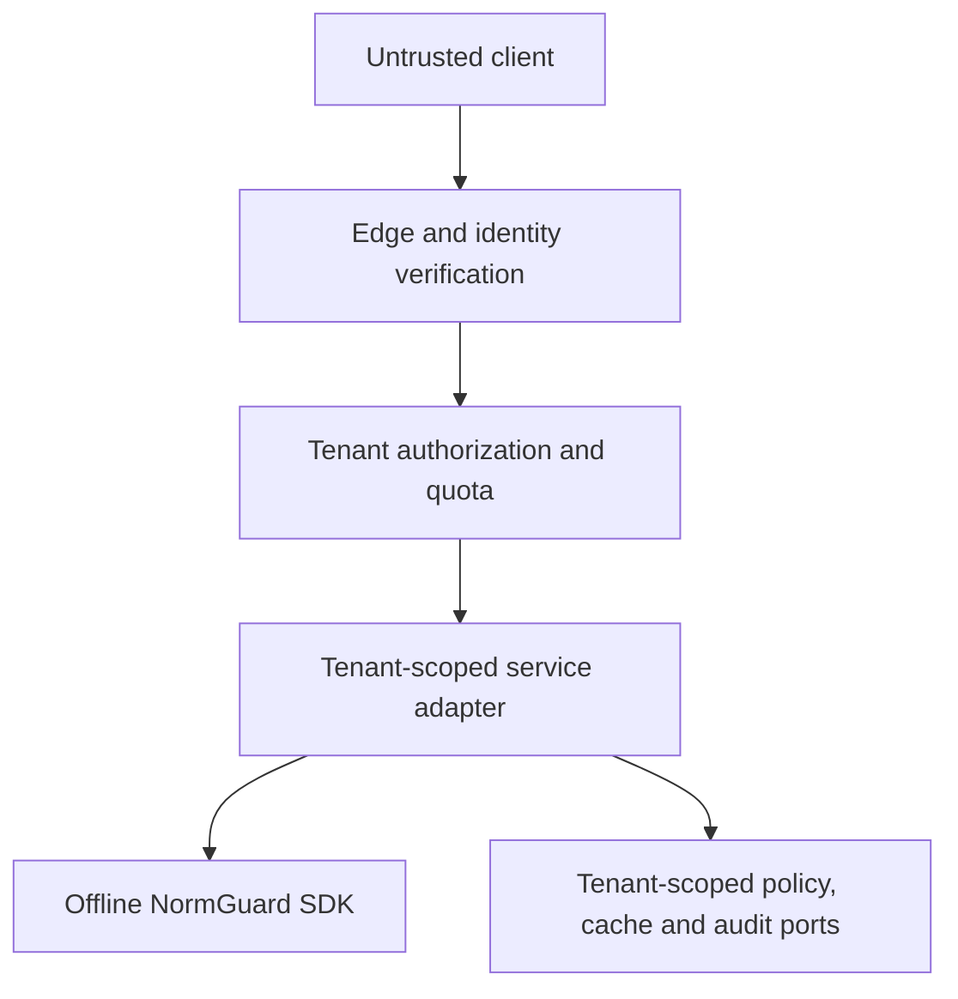

# ADR 0005: Define the hosted-service security boundary before implementation

- **Status:** Proposed
- **Date:** 2026-11-09
- **Decision owners:** NormGuard maintainers and adopting service owner
- **Issue:** #101
- **Related:** ADR 0003, NG-T22, B-002

## Context

NormGuard Safety Core is an offline deterministic library. It has no authenticated
principal, tenant, network, database or shared cache concept. Wrapping the SDK in an
HTTP framework would add a transport, but would not supply authentication,
authorization or tenant isolation.

NG-T22 and readiness blocker B-002 therefore remain blocked for every hosted or
multi-tenant deployment. This decision defines the minimum service boundary that a
future implementation must satisfy before either status can change.

## Decision

A hosted NormGuard service must be a separate adapter whose only route to text
normalisation is the existing public SDK. The adapter is responsible for identity,
tenant authorization, tenant-scoped policy selection, quotas, storage/cache isolation,
network controls and tenant-safe telemetry. It must never become a second source of
normalisation or policy-verification semantics.

The architecture is cloud-neutral. Identity provider, policy store, cache, rate-limit
store, audit sink and telemetry exporter are ports selected by the adopting platform.
Every port must preserve the same deny-by-default tenant contract.

This ADR is a design contract only. It does not implement a hosted endpoint, close
B-002, change NG-T22, authorize deployment or establish production readiness.

## Trust boundaries

The edge authenticates a principal but does not authorize tenant access. Authorization
occurs inside the service for every request and every resource. The SDK receives only
the already selected, verified tenant policy and bounded input. It does not receive
bearer credentials or perform network I/O.

## Identity and request context

The identity adapter must return a verified immutable principal containing:

- issuer and subject identifiers;
- token audience and expiry validation result;
- authentication strength when required by policy;
- platform roles or groups as untrusted authorization inputs;
- a correlation identifier generated by the service, never supplied as authority.

The authorization layer derives a request context containing `principal_id`,
`tenant_id`, `action`, `resource_type` and `resource_id`. Tenant identity must come from
an authorized membership/grant lookup. A path, header, body, policy bundle or token
claim cannot independently select the effective tenant.

Missing, ambiguous, expired or conflicting identity and tenant information is denied.
Service accounts are bound to explicit tenant/action grants; a broad technical role
does not imply access to every tenant.

## Deny-by-default authorization

Authorization evaluates the tuple `(principal, tenant, action, resource)` before:

1. reading or selecting a policy;
2. reading or writing cache/storage state;
3. invoking NormGuard;
4. exporting tenant-associated audit evidence;
5. running administrative or operational actions.

The decision interface returns only `ALLOW` or a bounded denial code. Unknown actions,
resources, roles, policy versions and decision errors are denied. List operations apply
the tenant predicate in the authoritative query; they must not fetch broadly and filter
afterward. Administrative support access requires a separate explicit grant, strong
authentication, time-bound approval and audit event.

## Tenant isolation contract

All resource keys use an opaque canonical `tenant_id` assigned by the platform. The
tenant key is mandatory at every layer:

| Layer | Mandatory isolation control |
|---|---|
| Request | authorized context is immutable after routing |
| Policy | lookup key includes tenant, policy ID and version/digest |
| Activation | floor and rollback authorization are tenant scoped |
| Cache | key includes tenant, policy digest, runtime schema and operation |
| Storage | repository methods require tenant; database policy enforces the predicate |
| Queue/job | tenant and authorization snapshot are integrity-bound to the message |
| Audit | events carry bounded tenant pseudonym and access decision, not raw content |
| Metrics | bounded aggregate labels; no tenant ID, raw text, digest or decision ID |
| Traces | tenant-safe correlation only; baggage cannot carry credentials or input |
| Backup/export | tenant ownership, encryption, retention and restore isolation verified |

Shared mutable global policy, cache or activation state is prohibited. Cache hits are
authorized before use. Cache invalidation is scoped to one tenant and immutable policy
identity. A cache miss or backend failure cannot fall back to another tenant, default
tenant or previously observed policy.

## Policy and signing boundaries

Tenant authorization does not replace signed-policy verification. A policy must satisfy
both controls: the caller may access the tenant resource, and the bundle must pass the
existing offline trust, signature, compatibility, activation-floor and rollback checks.

Trust stores may be platform-wide only when every key has an explicit permitted policy
and tenant scope enforced by the service. Otherwise they are tenant scoped. Private
signing keys remain outside the service and repository in a managed signing boundary.

## Rate limits and abuse controls

The adapter enforces independent bounded limits for principal, tenant and deployment.
Limits cover request rate, concurrent work, input bytes, batch size and cost-bearing
operations. The strictest applicable limit wins. Rejected work is not queued for later
execution and does not invoke NormGuard.

Rate-limit keys are derived from verified identifiers, not client-supplied labels or IP
address alone. Limit-store failure follows a declared fail-closed policy for protected
operations. Retry hints are bounded and must not disclose tenant capacity or activity.
Emergency controls support tenant suspension and global load shedding without changing
policy semantics.

## Errors, telemetry and data handling

External errors contain a stable code, request correlation ID and retryability only.
They must not reveal tenant existence, policy identifiers, authorization rules, input,
output, signatures, trust material, stack traces or backend topology. Not-found and
not-authorized responses are indistinguishable where resource enumeration is possible.

Logs and traces inherit the Safety Core privacy model. Raw input/output is prohibited by
default. Diagnostic capture requires explicit tenant policy, authorization, encryption,
retention/deletion controls and an audit trail. Telemetry sink failure cannot bypass
authorization or change semantic output; mandatory audit-sink failure blocks privileged
administrative changes.

## Network and deployment boundary

- TLS terminates only at an approved ingress and is re-established for internal hops.
- Service-to-service identity is authenticated; network location is not authorization.
- Egress is denied by default. Runtime normalisation and policy verification remain
  offline.
- Management, health and metrics endpoints are separated from tenant data routes.
- Read-only images, non-root execution, minimal filesystem access and secret injection
  from a managed store are required.
- Deployment identity, configuration and artifact digest are recorded without secrets.

## Required adversarial acceptance tests

Implementation is not eligible to close B-002 until independent tests demonstrate:

1. cross-tenant object IDs cannot read, write, list, normalize with or invalidate
   another tenant's resources;
2. conflicting path/header/body/token tenant values fail closed;
3. a service account cannot act outside explicit tenant/action grants;
4. list/search/export operations enforce tenant predicates at the data source;
5. cache keys, misses, invalidation and eviction cannot substitute cross-tenant state;
6. forged, expired, wrong-audience and replayed credentials are rejected;
7. authorization timeout/error and dependency failure deny access;
8. rate limits isolate noisy tenants and cannot be bypassed through identifier changes;
9. errors, logs, metrics and traces reveal no tenant existence or sensitive content;
10. queued/background work preserves the authenticated tenant boundary;
11. policy signature, activation and rollback controls still fail closed per tenant;
12. concurrent tenant workloads show no result, evidence or timing-derived data mix-up.

Tests must cover horizontal and vertical privilege escalation, confused-deputy flows,
IDOR/BOLA, cache poisoning, policy substitution, telemetry leakage and administrative
break-glass misuse. Synthetic tenants and inputs are required in repository CI.

## Implementation sequence

1. Freeze identity, authorization and tenant-context ports plus typed denial codes.
2. Implement tenant-scoped policy/activation repository and cache interfaces.
3. Add quota/rate-limit and tenant-safe audit/telemetry ports.
4. Build the thin SDK adapter with no alternate normalization semantics.
5. Execute cross-tenant property, concurrency and failure-injection tests.
6. Complete adopting-platform threat modelling, privacy review and capacity testing.
7. Obtain independent security review and explicitly reconcile NG-T22/B-002 evidence.

No later step may weaken an earlier boundary to make integration easier.

## Consequences

The design adds explicit platform responsibilities and prevents a minimal HTTP wrapper
from being mistaken for a secure service. It also increases integration work: identity,
storage and telemetry choices cannot be hidden inside the core library. This is accepted
because tenant isolation is an end-to-end property, not a middleware feature.

## Status and closure rule

NG-T22 remains `BLOCKED_FOR_HOSTED_SERVICE` and B-002 remains `BLOCKED`. Architecture
approval alone cannot change either status. Closure requires implemented controls,
passing adversarial isolation evidence on the exact artifact and deployment boundary,
and independent review of unresolved findings and accepted residual risk.
