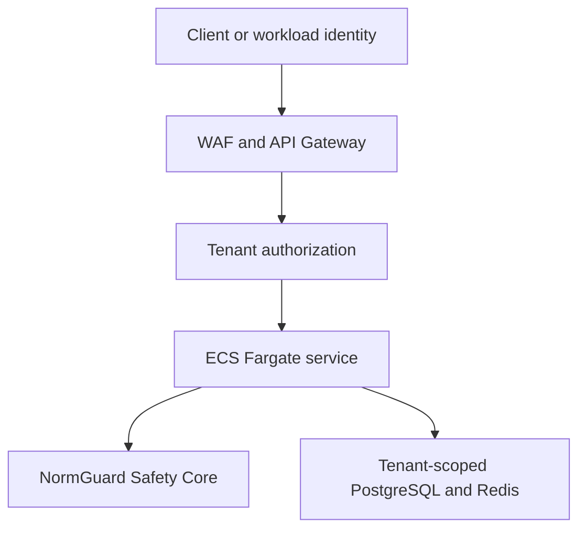

# ADR 0006: Freeze the initial production hosted-service profile

- **Status:** Proposed
- **Date:** 2026-11-20
- **Decision owners:** NormGuard maintainers, security owner and adopting platform owner
- **Issue:** #118
- **Related:** #117, ADR 0005, NG-T22, B-001, B-002 and B-003

## Context

The private Hugging Face CPU Basic pilot proved a narrow, single-tenant deployment and
its declared representative workload. It did not prove tenant isolation, production
availability, a production SLA or independent security assurance. Implementing a
general hosted service without first freezing one target profile would make security
and capacity evidence ambiguous.

This decision freezes the first production candidate. It is deliberately narrower than
a global SaaS platform and does not alter the cloud-neutral Safety Core or ADR 0005.

## Decision

The initial production candidate is a managed, stateless, multi-tenant HTTP API in one
AWS region (`eu-west-2`). It runs the existing public NormGuard SDK in non-root ECS
Fargate tasks behind API Gateway, a private load-balancing boundary and AWS WAF. It has
no GPU dependency and no public task IP.

Identity uses an external OIDC provider. API Gateway validates issuer, audience,
signature and token lifetime; the service still performs deny-by-default authorization
for every `(principal, tenant, action, resource)` tuple. A verified identity is not an
authorization decision.

The service remains stateless for request content. PostgreSQL is the authoritative
store for tenant grants, immutable policy metadata and activation state. Database row
security is defence in depth, not a replacement for tenant predicates in repository
methods. Redis may hold quotas and immutable policy cache entries only when every key is
tenant scoped. Raw request and normalized text are neither persisted nor emitted to
telemetry.

The machine-readable profile is
[`../production-hosted-service-profile.json`](../production-hosted-service-profile.json).
It is the authoritative input to later implementation and production-like capacity
evidence.

## Architecture

The administrative control plane uses separate routes, roles and audit events. Tenant
data routes cannot activate policies, change grants or bypass quotas. Signing keys are
outside the runtime service in a managed signing boundary; the service receives signed
policy bundles and public trust material only.

## Request and data flow

1. WAF applies coarse abuse controls and API Gateway validates the OIDC credential.
2. The service derives the effective tenant from an authoritative active grant. A path,
   header, body or untrusted claim cannot independently select it.
3. Authorization checks the requested action and resource before policy/cache access.
4. Principal, tenant and deployment quota checks run before NormGuard invocation.
5. The service loads the tenant's immutable policy identity and verifies the signed
   bundle through the existing Safety Core boundary.
6. NormGuard processes bounded in-memory text. The response is returned without content
   persistence.
7. A bounded audit event records the pseudonymous tenant, principal, action, outcome,
   artifact identity and correlation ID; it never records input or output text.

## Frozen operational targets

These values are objectives for readiness testing, not achieved SLO or SLA claims:

- monthly service availability target: 99.9%;
- p95 service latency target: 750 ms for the frozen representative request profile;
- successful throughput target: at least 10 requests/second per production task;
- error-rate target: at most 0.1%, excluding authenticated client errors and deliberate
  rate-limit responses;
- recovery-time objective: 30 minutes;
- recovery-point objective: 5 minutes for control-plane state;
- zero permitted cross-tenant disclosure and zero unauthorized policy activation.

Autoscaling, deployment minimums and quotas are configured limits, not evidence of
capacity. B-003 closes only after sustained tests capture platform CPU, RSS/memory,
throttling, saturation, scaling and failure behavior for the exact artifact and target.

## Security and privacy boundaries

- TLS is required at ingress and for internal service and data-store connections.
- Runtime egress is denied except to explicitly approved AWS service endpoints.
- Secrets come from Secrets Manager; envelope encryption uses KMS and rotation is
  exercised before readiness approval.
- Fargate tasks use a read-only root filesystem, non-root user, dropped Linux
  capabilities and a task role with least privilege.
- Policy bundles are immutable and digest addressed. Activation is a separate,
  tenant-authorized control-plane operation with rollback protection.
- Tenant identifiers are pseudonymous in audit events and prohibited as metrics labels.
- Raw input/output, credentials, signatures, signing keys and policy bodies are
  prohibited from logs, metrics, traces and audit records.
- Backups cover control-plane state only and must demonstrate tenant-scoped restore.
- Default audit retention is 90 days; security retention changes require documented
  approval and data-protection review.

## Availability and failure behavior

The service fails closed when identity, authorization, policy verification, mandatory
audit or protected quota dependencies fail. It does not fall back to a default tenant,
default policy or previously observed cross-tenant state. A last-known-good policy may
continue only for the same tenant when its signed identity and activation state remain
valid under the declared outage policy.

Production deployment uses at least two tasks across availability zones. Rolling
deployment retains a verified last-known-good artifact. Health reports process liveness;
readiness requires verified startup configuration and dependencies without exposing
tenant or policy details.

## Alternatives considered

### Keep Hugging Face Spaces as the production target

Rejected for the initial multi-tenant production profile. The private pilot remains
useful evidence, but its control surface and platform telemetry are insufficient for the
declared tenant-isolation and production-capacity claims.

### Kubernetes/EKS

Deferred. It offers more scheduling and policy control but adds cluster ownership and
operational cost that are not justified for the initial CPU-only service.

### Single-tenant deployment per customer

Retained as a lower-risk commercial deployment option, but it does not prove the
multi-tenant NG-T22 scope selected by this profile.

## Required evidence before acceptance

1. Contract and property tests for identity, grants and tenant-context derivation.
2. Cross-tenant IDOR/BOLA, cache, quota, telemetry and concurrency adversarial tests.
3. Failure injection for OIDC/JWKS, PostgreSQL, Redis, audit and policy dependencies.
4. KMS/secrets rotation, rollback, backup/restore and tenant-offboarding exercises.
5. Independent review bound to the exact commit, artifact and deployment profile.
6. Sustained production-like capacity evidence against the exact target configuration.
7. An operational ownership, alerting, incident-response and on-call acceptance record.

## Status and non-claims

This ADR freezes a production candidate profile; it does not implement the service,
close B-001/B-002/B-003, change NG-T22, establish an SLA, authorize customer traffic or
constitute independent security assurance. Those statuses change only through their
declared closure evidence and a separate readiness decision.
