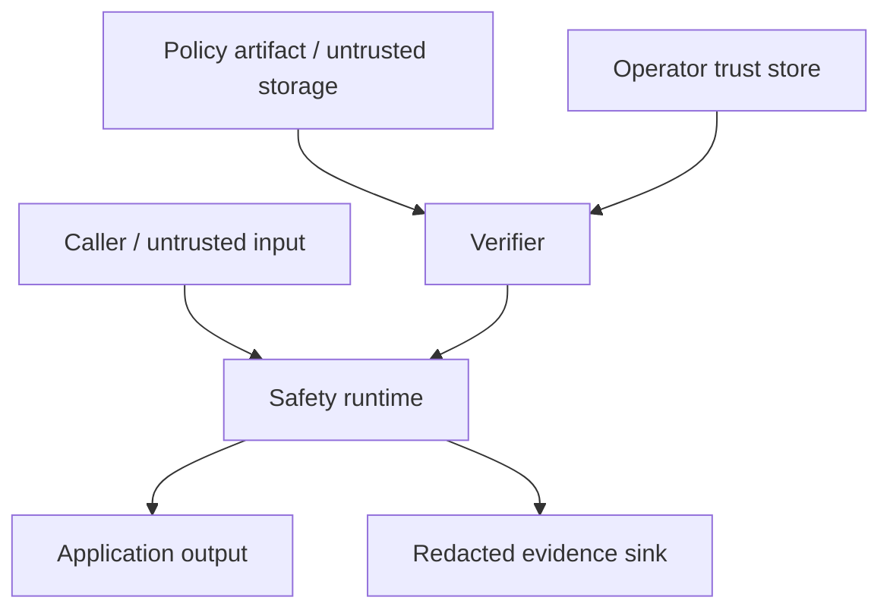

# NormGuard Safety Core threat model

- **Status:** Proposed
- **Date:** 2026-10-21
- **Scope:** Phase 3 offline Python SDK and CLI
- **Issue:** #62
- **Architecture:** [ADR 0003](adr/0003-safety-core-architecture.md)

## Purpose

This document identifies security and privacy risks for the first NormGuard Safety
Core vertical slice. It treats input text, policy bundles and filesystem artifacts
as untrusted. It covers the embedded Python runtime and CLI; future network and
multi-tenant risks are documented as design requirements but remain out of scope
for implementation.

The security objective is not to prove that arbitrary language transformation is
safe. It is to make a narrow set of governed transformations deterministic,
verifiable, bounded and auditable.

## Assets

| Asset | Required property |
|---|---|
| Protected source terms and offsets | Integrity and exact preservation under P0/P3 |
| Normalised output | Integrity, deterministic provenance and correct policy use |
| Policy bundle | Authenticity, integrity, version compatibility and rollback control |
| Reviewer approvals and provenance | Integrity and accountability |
| Signing keys and trust roots | Confidentiality and integrity |
| Evidence artifacts | Integrity, authenticity where required, and confidentiality |
| Input text | Confidentiality and controlled retention |
| Runtime configuration and limits | Integrity |
| Package, lockfile and release artifacts | Integrity and provenance |
| Availability budget | Resistance to resource exhaustion |

## Actors

- **Policy author:** proposes policy content but cannot approve publication alone.
- **Policy reviewer:** independently reviews content and evidence.
- **Policy publisher:** signs and publishes approved immutable bundles.
- **Application operator:** configures trust roots, activation state and limits.
- **Application caller:** submits text and receives a result.
- **Auditor:** reads authorized evidence without changing policy or output.
- **External attacker:** controls input text or files and may probe the CLI.
- **Compromised contributor or dependency:** attempts supply-chain manipulation.
- **Future tenant:** must not access another tenant's policy, text or evidence.

## Trust boundaries

Boundary rules:

1. Text is data and cannot modify policy, configuration, trust roots or limits.
2. A stored policy is not trusted until integrity, signature, compatibility and
   activation checks succeed.
3. Trust stores and signing keys are administered outside untrusted inputs and
   repository content.
4. Evidence sinks are separate from normal output and default to content-free
   metadata.
5. Filesystem paths supplied to the CLI remain untrusted.

## Assumptions

- The host operating system and Python interpreter are maintained and supported.
- Operators protect trust-root configuration and signing credentials.
- Package installation uses the committed lock and approved distribution channel.
- Applications enforce access control around text before and after the embedded
  core.
- The initial core has no network access.
- Cryptographic primitives come from maintained libraries rather than custom
  implementations.

A violation of an assumption becomes an explicit residual risk or incident, not a
silent success.

## Security objectives

- Only authorized, compatible and non-rolled-back policies execute.
- P0 and P3 surfaces are not transformed.
- P1 emits only its approved alias and P2 only its declared bounded operation.
- Identical authorized inputs produce identical semantic decisions.
- Untrusted text cannot issue runtime instructions.
- Failures cannot produce partially trusted output.
- Raw sensitive text is absent from evidence and logs by default.
- CPU, memory and artifact growth remain bounded.
- Releases and evidence can be independently verified.

## Threat analysis

Threat IDs are stable and should be referenced by tests, incidents and follow-up
issues.

| ID | Threat | Impact | Required controls | Verification |
|---|---|---|---|---|
| NG-T01 | Policy content is modified after approval | Unauthorized transformations | Canonical bytes, SHA-256, signature verification, immutable policy identity | Mutated byte/property tests fail before runtime |
| NG-T02 | Attacker publishes a policy with a valid shape but no authority | Policy substitution | Configured trust roots, signer allowlist, policy-ID allowlist, separation of duties | Unknown signer and wrong policy ID are rejected |
| NG-T03 | Valid older policy is replayed | Reintroduced vulnerability or rule drift | Activation floor, monotonic version state, explicit audited emergency rollback | Downgrade tests fail closed |
| NG-T04 | Unsupported schema is interpreted permissively | Semantic mismatch | Closed schemas, explicit compatibility range, reject unknown critical fields | Forward/backward incompatibility contract tests |
| NG-T05 | Overlapping rules create nondeterministic output | Integrity and audit failure | Leftmost-longest rule, class priority, stable rule-ID tie-break, duplicate rejection | Permutation and property tests |
| NG-T06 | Input contains prompt-like instructions to bypass controls | Protected-term corruption | Treat all text as inert data; no LLM/tool execution; configuration cannot originate in text | Adversarial injection corpus produces governed results |
| NG-T07 | Crafted regex or rule set causes catastrophic execution | Denial of service | Safe pattern subset or engine, pattern/rule limits, construction-time validation, runtime deadline | Complexity benchmarks and adversarial patterns |
| NG-T08 | Oversized input or match explosion consumes resources | Denial of service | Input-byte, token, match, output and evidence limits; typed limit failure | Boundary and fuzz tests |
| NG-T09 | Malformed Unicode corrupts offsets or identifiers | Integrity failure | Declared Unicode policy, original-byte/text accounting, offset invariants, fail closed | Unicode property and regression fixtures |
| NG-T10 | Raw customer text leaks through logs, traces or evidence | Confidentiality breach | Digest-only evidence default, structured redaction, no raw metric labels, explicit diagnostic opt-in | Log/evidence scanning tests |
| NG-T11 | Dictionary, alias or policy metadata contains secrets | Confidentiality breach | Policy content classification, secret scanning, exclude confidential aliases from logs | CI secret scan and evidence tests |
| NG-T12 | CLI path escapes an approved workspace or follows unsafe links | Unauthorized file access | Explicit paths, canonical path checks where constrained, safe open semantics, no recursive discovery by default | Traversal and symlink tests |
| NG-T13 | Parser triggers code execution or unsafe object construction | Host compromise | Data-only parser, no pickle/eval/dynamic import, strict size/depth limits | Malicious fixture tests and dependency review |
| NG-T14 | Dependency or release artifact is compromised | Code execution or semantic drift | Locked dependencies, hashes, minimal dependencies, SBOM, provenance, vulnerability review | Clean locked install and release verification |
| NG-T15 | Evidence is altered or paired with the wrong output | False audit conclusion | Canonical evidence, output/policy/input digests, optional signing, decision IDs | Tamper and cross-pair tests |
| NG-T16 | Partial processing returns output after verification failure | Safety bypass | Verify before normalising, atomic result construction, typed terminal errors, no fallback policy | Fault-injection tests |
| NG-T17 | Concurrent calls share mutable state | Cross-request corruption | Immutable verified policy, no global request data, concurrency tests | Parallel deterministic tests |
| NG-T18 | Error messages expose input, paths or policy secrets | Confidentiality breach | Stable error codes, sanitized messages, debug mode separated and access-controlled | Error snapshot and leakage tests |
| NG-T19 | Unbounded observability cardinality degrades systems | Availability/cost impact | No text, digest or decision ID in metric labels; bounded dimensions | Metric schema tests |
| NG-T20 | Reviewer roles are fabricated or approvals reused | Governance bypass | Approval identity binding, policy digest binding, two-person rule for publication | Approval mismatch and replay tests |
| NG-T21 | Signing key is compromised | Unauthorized trusted policy | Key IDs, rotation, revocation metadata, short publication workflow, incident response | Revoked signer tests and rotation exercise |
| NG-T22 | Future service exposes cross-tenant data | Confidentiality/integrity breach | Tenant-scoped authz, storage, caches, rate limits and telemetry | Required before service approval; not satisfied by core |
| NG-T23 | Caller mistakes review-required output for approved output | Unsafe downstream action | Typed status, distinct CLI exit code, explicit P3 evidence, integration guidance | Contract tests and example integration |
| NG-T24 | Hashes are treated as authorization | Unauthorized policy use | Documentation and API require signature/trust verification for published policies | API misuse tests where feasible |

## Prompt injection and model misuse boundary

NormGuard Safety Core does not call an LLM, execute tools, follow links, interpret
instructions or retrieve content. Phrases such as “ignore the policy,” encoded
instructions, markup, role labels and tool-call syntax are ordinary input
characters.

If a future LLM-assisted policy-authoring workflow is introduced, it belongs to a
separate untrusted authoring zone. Generated proposals require the normal review,
approval and signature lifecycle and cannot publish or activate themselves.

NormGuard protects governed text transformations. It does not by itself prevent
prompt injection in downstream LLM applications.

## Privacy model

Default evidence follows data minimisation:

- record a domain-separated input digest, byte length and policy digest;
- record rule IDs, offsets, decision types, counts, durations and error codes;
- omit source text, output text and unmatched context;
- prevent raw values from becoming metric attributes;
- define retention at the consuming application boundary;
- permit diagnostic capture only through an explicit policy with access control,
  encryption, retention and deletion requirements.

Plain unsalted digests can enable dictionary attacks for predictable short terms.
The evidence design must therefore choose a domain-separated keyed digest when
cross-system reproducibility is unnecessary, or document the inference risk when
a public reproducible digest is required.

## Cryptographic design requirements

The signature design spike must select maintained primitives and specify:

- canonical payload bytes;
- algorithm and minimum security parameters;
- signature envelope format;
- signer/key identifier;
- trust-root distribution;
- key rotation and revocation;
- offline verification;
- timestamp semantics and clock assumptions;
- policy-identity binding;
- approval-evidence binding;
- failure behaviour.

Private signing keys must never be stored in this repository, policy bundles,
container images, CI logs or runtime evidence. Cloud KMS or an equivalent managed
signing service is preferred for publication. Local development keys must be
clearly non-production and isolated.

## Availability and performance controls

Before implementation is promoted:

- freeze maximum input bytes, rules, pattern length, matches and evidence records;
- choose a safe matching strategy and benchmark adversarial worst cases;
- measure p50, p95 and p99 latency plus peak memory in a declared environment;
- ensure limit failures do not emit partially normalized output;
- keep policy verification separate so applications may cache immutable verified
  policies safely;
- key caches by tenant where applicable, policy digest and runtime schema version.

Performance optimisations must preserve trace and policy semantics.

## Secure development and CI requirements

The Phase 3 CI design must include:

- locked dependency installation;
- lint, type, unit and contract tests;
- property tests for determinism and offset invariants;
- fuzzing for parsers, Unicode and rule interactions;
- adversarial prompt-like and resource-exhaustion fixtures;
- policy/evidence mutation and signature failure tests;
- secret scanning;
- dependency and licence review;
- SBOM generation for releases;
- artifact digest verification;
- reproducible build or artifact comparison where supported.

Security tests must use synthetic fixtures and explicitly approved safety
calibration data. They must not open sealed ESCI partitions.

## Failure and incident handling

The core fails closed for trust, compatibility, integrity, ambiguity and limit
errors. It returns no normalized output on terminal failures. Review-required is a
successful governed outcome, not an error, but downstream applications must handle
it explicitly.

Operational runbooks must cover:

1. unsafe transformation report;
2. policy or evidence tampering;
3. signing-key or trust-root compromise;
4. accidental sensitive-data logging;
5. dependency compromise;
6. availability degradation;
7. emergency policy deactivation or rollback.

Each incident record should identify runtime version, policy identity and digest,
decision/evidence identifiers, affected boundaries and containment action without
copying sensitive text unnecessarily.

## Residual risks

- A correctly signed but poorly reviewed policy can still encode unsafe semantics.
- The safety suite cannot prove correctness for all languages or Unicode sequences.
- Digest-only evidence reduces leakage but also reduces forensic readability.
- Host compromise can bypass process-level controls and read application memory.
- Offline operation does not remove package supply-chain risk.
- Future service deployment introduces authentication, authorization, tenancy and
  network risks not implemented by this phase.
- NormGuard cannot guarantee downstream systems use review-required or failure
  statuses correctly.

These risks require governance, application integration controls and operational
testing in addition to library tests.

## Exit criteria for the vertical slice

- [x] Every NG-T01 through NG-T21 and NG-T23/24 has an implemented control,
  accepted residual risk or tracked blocker.
- [x] NG-T22 remains an explicit blocker for any multi-tenant service.
- [x] Tampered, unsigned, unauthorized, incompatible and rolled-back policies fail
  before text processing.
- [x] P0 retention is 100% and unauthorized transformations are zero on the
  approved safety suite.
- [x] Default logs and evidence contain no raw test text.
- [x] Repeated runs are semantically deterministic.
- [x] Resource limits and benchmark environment are frozen and tested.
- [x] Key compromise and sensitive-log incidents have documented response steps.
- [ ] Independent security review is recorded before a production claim.

The Phase 3 reconciliation and remaining blockers are recorded in the
[release-readiness review](releases/safety-core-phase-3-readiness.md). Completion
of engineering exit criteria authorizes only its stated controlled-pilot scope.

## Review triggers

Update this threat model when a new parser, pattern engine, signature mechanism,
policy source, evidence sink, language, network API, tenant boundary or
LLM-assisted workflow is introduced.
